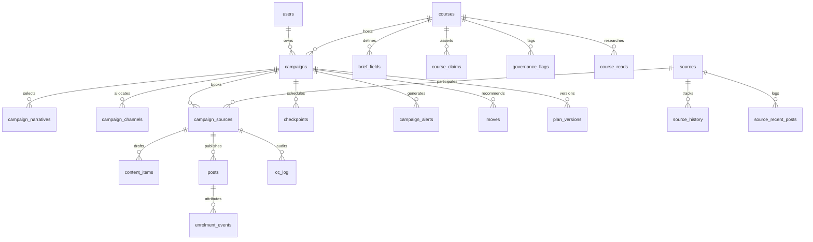

# HireIQ — Database Schema & Architecture Guide

> **Database Engine**: MySQL 8.4 LTS (or MariaDB 10.6+)  
> **Character Set**: `utf8mb4`  
> **Collation**: `utf8mb4_unicode_ci`  
> **Primary Schema File**: [`database/schema.sql`](../database/schema.sql)

---

## 1. Overview & Design Principles

The HireIQ database schema is designed according to four strict architectural constraints:

1. **Zero Hardcoding**: All dynamic configuration—including district names, qualification options, channel priors, ranking weights, governance rules, and funnel conversion rates—lives in database tables (`lookup_values`, `channel_priors`, `governance_rules`, `app_settings`) and is served via `GET /api/lookups`.
2. **Strict Aggregate Cohort Anonymity (RR-H01 / RR-H02)**: The database stores **zero student or learner PII**. Learners are never modeled as individual records. Registrations and enrolments arrive solely as aggregated daily counts tied to campaign tracking tags (`enrolment_events`).
3. **Plan Versioning & Immutability**: Predictions generated by Agent A09 are frozen at campaign creation (`campaigns.pred_frozen`) as Version 1. Later reallocations or strategy changes are appended to `plan_versions` to maintain auditability.
4. **Relational Integrity**: Foreign keys with `ON DELETE CASCADE` ensure clean cascading deletions of child records (such as narratives, channels, and content items) when a draft campaign or test course is deleted.

---

## 2. Entity-Relationship Diagram (ERD)



---

## 3. Table Groupings & Data Dictionary

### 3.1 System Configuration & Lookups

| Table | Primary Key | Description |
| :--- | :--- | :--- |
| `lookup_values` | `id` (Auto-inc) | Dynamic categories (`district`, `source_type`, `skill_domain`, `qualification`, `kpi`, `objective`) with JSON metadata. |
| `channel_priors` | `(objective, channel)` | Prior channel effectiveness matrix used by Agent A06 (measurability score, channel role, ITI multiplier). |
| `governance_rules` | `code` (VARCHAR) | Formal governance rules (RR-H01 to RR-H07) with enforcement levels (`Refuse`, `Block`, `Hold`, `Warn`, `Info`). |
| `app_settings` | `setting_key` (VARCHAR) | Global thresholds (minimum cohort size, funnel priors, reliability gates, demo dates). |

### 3.2 Users & Authentication

| Table | Primary Key | Description |
| :--- | :--- | :--- |
| `users` | `id` (VARCHAR) | User accounts with bcrypt hashed passwords and RBAC roles (`Admin`, `Manager`, `Fairness reviewer`, `Viewer`). |

### 3.3 Courses & Course Briefs

| Table | Primary Key | Description |
| :--- | :--- | :--- |
| `courses` | `id` (VARCHAR) | Skilling programmes and batches (`title`, `batch`, `provider`, `target`, `ceiling`, `form` JSON). |
| `brief_fields` | `(course_id, field_key)` | 9 required, 5 strong, and optional brief fields with confirmation status (`Confirmed`, `Unconfirmed`, `Missing`). |
| `course_claims` | `id` (VARCHAR) | Asserted placement/outcome claims undergoing review (RR-H03) with evidence file links. |
| `governance_flags` | `id` (VARCHAR) | High-level course governance status (`Cleared`, `Under review`, `Refused`). |
| `course_reads` | `id` (VARCHAR) | Intelligence analyses generated by Agent A02 (cohort demand, competitor bootcamps, risk factors). |
| `watch_handles` | `id` (VARCHAR) | Social listening handles monitored for community chatter. |

### 3.4 Influence Sources (Creator Bank)

| Table | Primary Key | Description |
| :--- | :--- | :--- |
| `sources` | `id` (VARCHAR) | 455+ influence sources (creators, placement cells, alumni, educators) with demographics, rate cards, and consent status. |
| `source_history` | `id` (Auto-inc) | Historical delivery records of past batch bookings (Delivered, Backed out, Declined) used by reliability gates. |
| `source_recent_posts`| `id` (Auto-inc) | Recent sample posts with observed engagement rates and view counts. |
| `source_snapshots` | `(source_id, month)` | Monthly follower and audience growth trends. |
| `source_activity` | `id` (Auto-inc) | Audit log of profile updates, enrichments, and rate card changes. |

### 3.5 Campaigns & Wizard State

| Table | Primary Key | Description |
| :--- | :--- | :--- |
| `campaigns` | `id` (VARCHAR) | Cohort campaigns with target geography, qualifications, budget, status (`Draft`, `Live`, `Closed`), and frozen predictions. |
| `campaign_narratives`| `id` (VARCHAR) | Narratives generated by Agent A05 with scores, hold status, and primary/supporting roles. |
| `campaign_channels` | `(campaign_id, name)` | Channel percentage allocations planned by Agent A06 (must sum to 100%). |
| `campaign_sources` | `id` (VARCHAR) | Booked creators (`cc`) with deal terms, rates, post counts, deliverables, and tracking tags (`hq-{camp}-{src}`). |
| `cc_log` | `id` (Auto-inc) | Communication and negotiation timeline with booked creators. |
| `content_items` | `id` (VARCHAR) | Post concepts and scripts generated by Agent A08 with hooks, beats, captions, and `#ad` compliance tags. |

### 3.6 Live Operations, Telemetry & Attribution

| Table | Primary Key | Description |
| :--- | :--- | :--- |
| `posts` | `id` (VARCHAR) | Live social posts with verified URLs, view counts, engagements, and tracked clicks. |
| `enrolment_events` | `id` (Auto-inc) | Aggregated daily registration and enrolment counts received from Resolence LMS per tracking tag. |
| `comments` | `id` (Auto-inc) | Social comments analyzed by Agent A11 for sentiment, scepticism, and intent. |
| `checkpoints` | `id` (Auto-inc) | Performance review milestones (72 Hours, Day 7, Day 14, Close) with verdicts (`Ahead`, `On track`, `Behind`). |
| `campaign_alerts` | `id` (Auto-inc) | Actionable notifications (scepticism spikes, overdue deliverables, low conversion rates). |
| `moves` | `id` (VARCHAR) | Diagnostic recommendations generated by Agent A12 (budget reallocations, creator additions). |
| `plan_versions` | `id` (Auto-inc) | Snapshots of campaign plan iterations (v1, v2, v3) triggered by accepted moves. |

### 3.7 Governance, Integrations & Observability

| Table | Primary Key | Description |
| :--- | :--- | :--- |
| `files` | `id` (VARCHAR) | Metadata for uploaded brochures, syllabi, evidence letters, and export reports stored in `backend/uploads/`. |
| `connectors` | `id` (VARCHAR) | Platform integration status (YouTube, Meta, Resolence) with AES-256-GCM encrypted tokens. |
| `fairness_escalations`| `id` (Auto-inc) | Log of rejected targeting attempts violating non-discrimination rules (RR-H01 / RR-H02). |
| `audit_log` | `id` (Auto-inc) | Security audit trail of data modifications, deal approvals, and user logins. |
| `agent_runs` | `id` (Auto-inc) | AI service observability log (agent ID, duration ms, LLM usage flag, output status). |

---

## 4. Seeding & Data Management

### Seeding Script (`backend/scripts/seed.js`)
The database is initialized by running:
```bash
cd backend
npm run seed
```
This script executes three tasks in transaction-safe batches:
1. **Schema DDL**: Executes [`database/schema.sql`](../database/schema.sql) to create all 28 tables.
2. **Configuration Seed**: Ingests [`database/seed/config_seed.json`](../database/seed/config_seed.json) into `lookup_values`, `channel_priors`, `governance_rules`, and `app_settings`.
3. **Prototype Seed**: Ingests [`database/seed/prototype_seed.json`](../database/seed/prototype_seed.json) to populate initial courses (`f1`, `f2`), 455 creator bank profiles, baseline campaigns, and connectors.

### Backup & Export
To perform a full schema and data dump of the HireIQ database:
```bash
mysqldump -u hireiq -p hireiq --single-transaction --routines --triggers > hireiq_backup.sql
```

### Restore
To restore an existing dump into a clean database:
```bash
mysql -u hireiq -p hireiq < hireiq_backup.sql
```
