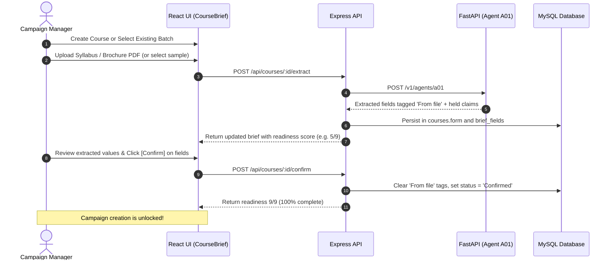
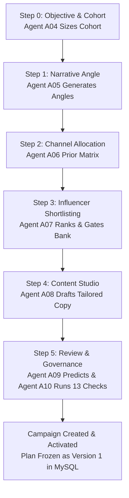
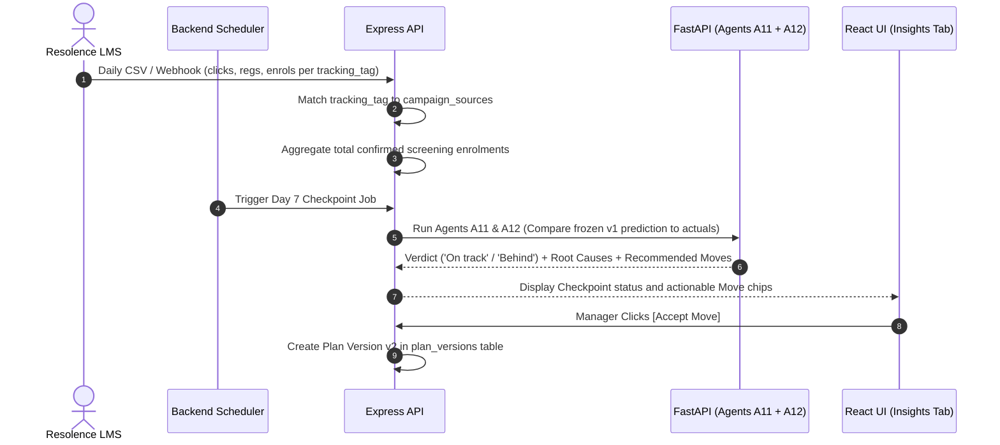

# HireIQ — User Workflows & Operational Lifecycles

> **Operational Guide**: Detailed step-by-step walkthroughs of the four primary business workflows in HireIQ.

---

## Workflow 1: Course Onboarding & Brief Readiness (9/9)

Before any campaigns can be created or launched, the skilling course brief must be defined and confirmed.



### The 9 Required Fields
1. **Course Name (`title`)**: Official name of the skilling programme.
2. **Course Link (`link`)**: Public syllabus or landing page.
3. **Skill Domain & Level (`domain`)**: e.g., AI/ML, Cloud Architecture, Manufacturing.
4. **Eligibility (`eligibility`)**: Educational criteria (screened against RR-H02 for non-discrimination).
5. **Duration & Mode (`duration`)**: e.g., 16 weeks, Hybrid (3 days in-centre).
6. **Delivery Locations (`locations`)**: Target districts / states.
7. **Batch Dates (`batch`)**: Batch identifier and start date.
8. **Enrolment Target & Cost Ceiling (`target`)**: Expected intake (e.g. 300) and max cost per student (e.g. ₹4,500).
9. **Registration Link (`regLink`)**: Tracked Resolence LMS registration portal.

---

## Workflow 2: The 6-Step Generative Campaign Wizard



### Step 0: Objective & Cohort Sizing
- **Inputs**: Campaign Name, Objective (e.g., *Getting onboarded*), KPI (*Screening enrolments*), Target Districts (multi-select), Qualification (e.g. *B.Tech final year*), Skill Background (*CSE, IT*), Age Band, Experience, Budget.
- **Agent A04 Orchestration**: Evaluates the cohort criteria against regional graduate population estimates and returns the aggregate pool size (e.g. 3,700). Screens free-text notes for prohibited criteria (RR-H01/RR-H02).
- **Auto-Save**: State immediately persists in `campaigns.wizard` and updates MySQL.

### Step 1: Narrative Angle
- **Agent A05 Orchestration**: Generates 4 candidate narrative angles categorized by class (e.g., *Speed to employment*, *Career outcome*, *Institutional endorsement*).
- **Claim Holding**: If a narrative relies on an unverified claim (such as "85% placement rate" without evidence per RR-H03), it is marked with an amber **Held** badge.
- **Selection**: The manager selects one Primary narrative and optionally one Supporting narrative, or types a custom angle.

### Step 2: Channel Planning
- **Agent A06 Orchestration**: Combines objective priors, cohort behavior multipliers, and channel measurability scores to allocate budget percentages across 7 channels:
  1. Programme's Own Page (Anchor, locked 10%)
  2. WhatsApp (Conversion)
  3. YouTube (Amplifier)
  4. Instagram (Amplifier)
  5. Campus Events (Conversion)
  6. Facebook (Community)
  7. LinkedIn (Community)
- **Validation**: Interactive sliders enforce that total allocation sums to exactly 100%.

### Step 3: Influencer Shortlisting
- **Agent A07 Orchestration**: Ranks all 455 Creator Bank profiles using trust, reach, quality, and fit weights. Enforces 6 strict gates:
  - Minimum 1,000 followers.
  - Institutional partner consent on file (RR-H06).
  - Past delivery reliability (cannot have backed out of $\ge 2$ of last 3 bookings).
  - Activity within the last 60 days.
- **Auto-Portfolio**: Clicking "Build auto-portfolio" shortlists 8 optimal creators matching the channel mix.

### Step 4: Content Generation
- **Agent A08 Orchestration**: Generates custom post concepts for each shortlisted creator.
  - Tailored to platform format (Instagram Reel, YouTube Short, WhatsApp Broadcast Card).
  - Language matching (Telugu, English, Code-mixed).
  - Script beats, hook lines, draft captions, and tracking URLs (`hq-{campaign}-{source}`).
  - Automated inclusion of `#ad` and `#sponsored` disclosures (RR-H04).

### Step 5: Review & Governance Freeze
- **Agent A09 Predictor**: Forecasts expected reach, click intervals, registrations, and screening enrolments (e.g., 30–84 enrolments) and estimated cost per enrolment (CPI).
- **Agent A10 Compliance**: Evaluates 13 compliance rules. All 13 must pass.
- **Create Campaign**: Freezes the forecast as Version 1 (`campaigns.pred_frozen`), schedules 4 checkpoints, sets status to `Live`, and materializes records in MySQL child tables.

---

## Workflow 3: Influencer Deal Operations & Delivery

Once a campaign is Live, each booked creator (`campaign_sources`) moves through a structured deal pipeline:

```
[Identified] ──▶ [Contacted] ──▶ [Negotiating] ──▶ [Confirmed] ──▶ [Delivered]
                                                        │
                                                        ▼ (If creator backs out)
                                                 [Backed out / Declined]
```

1. **Commercial Terms**: The manager records fee per post, deliverables count, hashtag requirements, and deal end date.
2. **Institutional Consent Gate (RR-H06)**: For placement cells and student networks, moving to `Confirmed` requires selecting a recorded consent basis and date.
3. **Content Approval**: Draft posts generated by Agent A08 are reviewed. Disclosures and claims are validated before approval.
4. **Post Publishing**: Once the post is live, the URL is submitted. Official APIs or manual inputs record views, likes, and comments.

---

## Workflow 4: Telemetry, Enrolment Attribution & Telemetry Insights



1. **Resolence Sync**: Resolence LMS delivers daily counts per tracking tag (`hq-{camp}-{source}`). No student identities are shared.
2. **Attribution**: The backend maps tags to booked creators and increments attributed enrolments.
3. **Milestone Checkpoints**: Checkpoints at **72 Hours**, **Day 7**, **Day 14**, and **Close** compare actual enrolments against the predicted time-decay band:
   $$\text{Expected Enrolments}(t) = \text{Prediction}_{\text{frozen}} \times \left(\frac{t}{T}\right)^{0.8}$$
4. **Insights & Moves**:
   - Agent A11 analyzes comment sentiment to detect scepticism spikes (RR-H05).
   - Agent A12 identifies bottlenecks and proposes costed reallocations (e.g., "Reallocate ₹40,000 from open feed to WhatsApp placement-cell broadcasts").
   - Accepting a move archives the change as a new plan version (`v2`, `v3`).
5. **Campaign Close**: The manager closes the campaign, logs post-campaign learnings, and updates historical delivery ratings in the Creator Bank.
